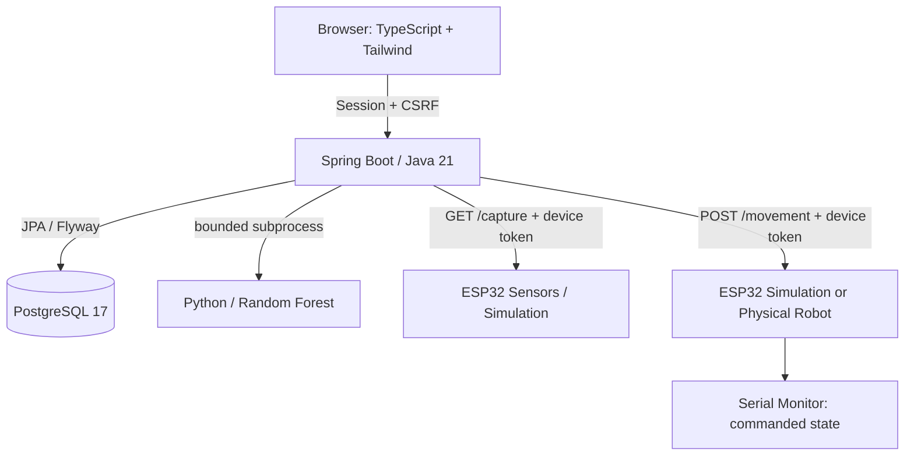

# PlantClassifier

PlantClassifier is a Spring Boot dashboard that captures environmental readings from an ESP32, stores them in PostgreSQL, runs a local Python Random Forest prediction, and sends authenticated robot commands. The simulation sketch supports the complete communication flow without motors. Sensor provenance and prediction status are visible in the dashboard.



The manual verification flow is **Browser → Spring Boot → ESP32 → Serial Monitor**. An HTTP acknowledgement confirms command acceptance, not physical movement.

## Stack and repository structure

- Java 21, Spring Boot 4.1.x, Spring MVC, Security, Validation and Data JPA.
- PostgreSQL 17, Flyway migrations; H2 for fast tests and PostgreSQL for migration tests.
- Python 3.12+; pinned NumPy, pandas, scikit-learn 1.9.0, SciPy and joblib.
- TypeScript, Tailwind CLI 4, Node 24; compiled static assets served by Spring.
- ESP32 Arduino Core 3.x, ArduinoJson 7, WiFi/WebServer, ESP32Servo and DHT library.

| Path | Purpose |
|---|---|
| `src/main/java/.../controller` | HTTP API and session-bound controller ownership |
| `src/main/java/.../service` | Device protocol, sensor persistence and bounded ML execution |
| `src/main/resources/db/migration` | Additive Flyway schema changes |
| `frontend` | TypeScript controls, keyboard state and Tailwind source |
| `src/main/resources/static` | Dashboard and compiled JS/CSS |
| `ESP32/PlantClassifier` | Simulated sensors and movement; optional calibrated real sensors |
| `ESP32/Movement` | Physical TB6612FNG/servo robot |
| `MLClassification` | Dataset, preserved deployed model, CLI and evaluation reports |
| `src/test`, `ESP32/tests`, `scripts` | Automated checks and isolated database tests |
| `docs` | Protocol, migration, security and verification details |

## Hardware

Physical motor firmware keeps the original pin assignments. The bridge is disabled before servo/PWM initialization; see [real hardware setup](docs/REAL_HARDWARE_SETUP.md) before any actuator power is connected:

| Component | Pin / setting |
|---|---|
| TB6612FNG AIN1 / AIN2 | GPIO 25 / 26 |
| PWMA / STBY | GPIO 27 / 32 |
| Servo signal | GPIO 22 |
| PWM | 5000 Hz, 8 bits, speed 0–255 |
| Servo center / left / right | 100° / 70° / 130° |
| Watchdog | 1500 ms |

Use the appropriate external motor supply and a common ground. Test first with wheels raised and a physical emergency disconnect. Startup, lost Wi-Fi and missing commands stop the motor. Direction reversal removes motor power before changing direction. PWM status is commanded state; there is no physical-motion feedback.

The simulation sketch uses GPIO 35 and 34 ADC inputs to derive temperature/humidity/pH for demonstrations. These are explicitly marked `simulated: true`, not calibrated measurements. It does not require a motor or servo. Optional real sensor mode uses DHT11 on GPIO 22 and a calibrated pH interface on GPIO 34; this sketch and the motor sketch are separate deployments.

## Local configuration

Copy `.env.example` to `.env` and replace placeholders. Never commit `.env`. Spring does not automatically read a shell `.env`; supply its variables in IntelliJ or export them securely before starting Java. Docker Compose reads `.env` automatically.

| Variable | Purpose / default |
|---|---|
| `POSTGRES_DB`, `POSTGRES_USER`, `POSTGRES_PASSWORD` | Compose database initialization; user/password required |
| `POSTGRES_PORT` | Host loopback port, `5433`; internal database port remains `5432` |
| `SPRING_DATASOURCE_URL` | Native JVM default `jdbc:postgresql://127.0.0.1:5433/plantclassifier` |
| `SPRING_DATASOURCE_USERNAME`, `SPRING_DATASOURCE_PASSWORD` | Native JVM database credentials; no secret fallback |
| `CONTROL_USERNAME`, `CONTROL_PASSWORD` | Browser operator account; password at least 12 characters |
| `DEVICE_TOKEN` | Independent shared ESP32 token, at least 32 random characters |
| `ESP32_URL`, `MOVEMENT_ESP32_URL` | Required device HTTP(S) origins; same device supported in simulation |
| `APP_HOST`, `APP_PORT` | Published Docker application address, `127.0.0.1:8080` |
| `SERVER_ADDRESS`, `SERVER_PORT` | Native Spring binding `127.0.0.1:8080`; Compose binds internally to `0.0.0.0` |
| `SESSION_COOKIE_SECURE` | Set `true` behind HTTPS; local HTTP default `false` |
| `ML_PYTHON_PATH` | Native Python executable or absolute virtualenv path, `python3` |
| `ML_SCRIPT_PATH`, `ML_WORKING_DIRECTORY` | `predict.py`, `MLClassification`; use repository root as native working directory |
| `ML_TIMEOUT` | Total process/stream deadline, `30s` |
| `ESP32_CONNECT_TIMEOUT`, `ESP32_READ_TIMEOUT` | Sensor HTTP limits, `2s` / `5s` |
| `MOVEMENT_CONNECT_TIMEOUT`, `MOVEMENT_READ_TIMEOUT` | Robot HTTP limits, `300ms` / `500ms` |
| `SENSOR_TEMPERATURE_MIN`, `SENSOR_TEMPERATURE_MAX` | Plausible input range, −40 / 85 °C; adapt to actual sensor specifications |

Generate credentials locally, for example `openssl rand -hex 32`. `.env.example` uses reserved documentation addresses; replace them with actual ESP32 addresses. `127.0.0.1` inside a container refers to that container, **not the ESP32 or host**. Ensure both host and container can reach the device Wi-Fi network.

## PostgreSQL and IntelliJ

```bash
docker compose up -d db
python3 -m venv .venv
.venv/bin/pip install -r MLClassification/requirements.txt
npm ci
npm run build
```

Open `pom.xml` in IntelliJ, select JDK 21, set repository root as working directory, and configure the native JVM environment variables above. Set `ML_PYTHON_PATH` to the absolute `.venv/bin/python` path. Run `PlantClassifierApplication`, or use `./mvnw spring-boot:run` from an appropriately configured shell. Open `http://localhost:8080` and sign in through the dashboard link.

Fresh databases migrate automatically and Hibernate validates the result. **Existing Hibernate-created databases need an explicit reviewed baseline**; follow [migration instructions](docs/MIGRATIONS.md) before upgrading. Do not delete Docker volumes or switch production to `create-drop`.

## Docker

```bash
docker compose --env-file .env config --quiet
docker compose up --build -d
docker compose logs --tail=100 app
```

The database healthcheck gates app startup. The image builds/tests TypeScript and Java, installs Python into `/opt/venv`, checks actual model loading, and runs Java as a non-root user. Only the prediction script, shared feature schema and existing model enter the runtime ML directory; local credentials and firmware are excluded. Python 3.12 in Ubuntu Noble supports the pinned scikit-learn release (requires Python ≥3.11).

Compose publishes application and database ports only on host loopback by default. To permit remote browser access, explicitly configure the host binding, firewall and HTTPS proxy; enable secure session cookies. ESP32 HTTP must remain on a trusted isolated network. No database, volume or historical data is automatically removed.

## Frontend development

```bash
npm ci
npm run typecheck
npm test
npm run build       # TypeScript and Tailwind
npm run build:ts
npm run build:css
npm run watch      # Watches both with coordinated process cleanup
```

Commit regenerated `static/js` and `static/css` with source changes. CI checks for drift. The dashboard retains its dark visual layout. Acquire control, then press W/A/S/D within 1.5 seconds. Last pressed key wins; releasing that key resumes a remaining held key. Steering-only commands stop propulsion. STOP, loss of focus or a failed command closes control; acquire again to resume. See [protocol](docs/CONTROL_PROTOCOL.md).

## Dedicated sensor and movement ESP32 boards

See [Dual ESP32 setup](docs/DUAL_ESP32_SETUP.md) for wiring, firmware, configuration,
compile-only checks and end-to-end validation. Sensor ESP32 #1 runs `PlantClassifier.ino`
with physical DHT11 readings and **pH (potentiometer simulation)** from GPIO34.
Movement ESP32 #2 runs `Movement.ino`, with motor simulation enabled by default.
Set `ESP32_URL` and `MOVEMENT_ESP32_URL` to their separate addresses.
No sensor firmware movement endpoints or movement firmware capture endpoint exist.
Do not flash boards or energize motors without separate approval.

## REST API and curl

All mutation requests to Spring require a browser session and a CSRF token. There is no public bypass for development. Static assets, `/login` and `/csrf` are public; sensor/control APIs require OPERATOR authorization.

| Endpoint | Result |
|---|---|
| `GET /csrf` | Session CSRF `token` and `headerName` |
| `GET /login` | Dark native form containing a session-bound CSRF token |
| `POST /login` | Spring Security form login; redirects on success |
| `GET /session` | Authentication status; never returns passwords or device tokens |
| `POST /logout` | CSRF protected STOP attempt and session invalidation |
| `POST /logout` | Session logout (CSRF required) |
| `POST /movement/session` | Stops device and acquires a new controller epoch |
| `POST /movement` | Typed ESP32 acknowledgement; requires command, speed, sessionId, sequence |
| `GET /sensors` | Latest saved measurement by descending ID, or 204 if empty |
| `POST /sensors/capture` | Saved measurement with explicit prediction status and provenance |

Example safe login setup for a local shell (requires `jq`; enter the actual password interactively; the temp directory is private):

```bash
umask 077
work=$(mktemp -d)
trap 'rm -rf "$work"; unset operator_password' EXIT
base=http://localhost:8080
read -r -p 'Operator username: ' operator_user
read -r -s -p 'Operator password: ' operator_password
printf '%s' "$operator_password" > "$work/password"
unset operator_password
curl -fsS -c "$work/cookies" "$base/csrf" > "$work/csrf"
csrf=$(jq -r .token "$work/csrf")
curl -fsS -b "$work/cookies" -c "$work/cookies" -H "X-CSRF-TOKEN: $csrf" \
  --data-urlencode "username=$operator_user" --data-urlencode "password@$work/password" "$base/login" >/dev/null
# Authentication rotates the session; fetch a new CSRF token.
curl -fsS -b "$work/cookies" "$base/csrf" > "$work/csrf"
csrf=$(jq -r .token "$work/csrf")
curl -fsS -b "$work/cookies" -H "X-CSRF-TOKEN: $csrf" -X POST "$base/movement/session" > "$work/control"
session=$(jq -r .sessionId "$work/control")
# Execute immediately within 1.5 s. STOP is the safest curl smoke check.
curl -fsS -b "$work/cookies" -H "X-CSRF-TOKEN: $csrf" -H 'Content-Type: application/json' \
  -d "{\"command\":\"STOP\",\"speed\":0,\"sessionId\":\"$session\",\"sequence\":1}" "$base/movement"
curl -fsS -b "$work/cookies" -H "X-CSRF-TOKEN: $csrf" -X POST "$base/sensors/capture"
```

A representative acknowledgement is `{"status":"OK","command":"STOP","speed":0,"simulated":true,"sessionId":"…","sequence":1}`. It does not claim measured motion. Sensor responses include `capturedAt` in UTC, nullable legacy `simulated`, and `predictionStatus` (`PENDING`, `SUCCEEDED`, `FAILED`, or legacy `NOT_REQUESTED`). ML failures preserve readings and return an explicit partial result.

Errors use `application/problem+json`: 400 invalid fields/JSON, 401 authentication, 403 authorization/CSRF, 409 stale control, 502 device communication/invalid response, 504 timeout, 503 persistence/capacity, 500 unexpected internal failure. Exception messages and device addresses are not exposed to browsers.

## ML evaluation and model storage

```bash
.venv/bin/python MLClassification/predict.py 25 60 7
.venv/bin/python MLClassification/train.py --report /tmp/evaluation.json
# Optional: create a NEW candidate, never overwrite model.pkl
.venv/bin/python MLClassification/train.py --report /tmp/candidate-evaluation.json --candidate /tmp/model-candidate.pkl
```

`features.py` fixes feature order to temperature, humidity, ph. The evaluation uses a stratified 80/20 split, seed 42, 100 trees, exact-feature duplicate handling and a separate test partition. [Actual evaluation report](MLClassification/evaluation.json): 8,800 training / 2,200 test examples, accuracy **0.9172727**, macro precision **0.9199366**, recall **0.9172727**, F1 **0.9169149**. The report includes class counts, weighted metrics and the full confusion matrix.

All 22 classes have 500 rows before splitting. No exact duplicate feature rows were removed. Source/group/time metadata is unavailable, so correlated or synthetic observations and data leakage cannot be ruled out; these metrics are not evidence of field accuracy. The original model was trained on all rows and cannot be evaluated independently using this same test subset. The held-out metrics refer to the newly evaluated candidate, not the preserved deployed model.

The deployed `model.pkl` remains byte-for-byte unchanged at 71,794,441 bytes. A separate compression experiment produced 6,869,282 bytes with identical predictions on 200 sampled rows; see [compression report](MLClassification/compression-report.json). Compression is worthwhile for future artifact distribution, at the cost of load/decompression time and loss of memory mapping. A validated model registry or Git LFS may be appropriate if versions grow; historical storage was not rewritten. Only load trusted joblib files, which can execute code.

Starting Python and loading the model once per request is retained for this project's scale. Two concurrent subprocess slots bound resource use; stdout and stderr are drained concurrently, each retaining at most 4096 bytes, under a total deadline. No persistent ML service was introduced.

## Tests and CI

```bash
./mvnw -B verify
scripts/test-postgres.sh
npm run typecheck && npm test && npm run build
scripts/test-firmware.sh
python3 -m py_compile MLClassification/features.py MLClassification/predict.py MLClassification/train.py
.venv/bin/python -m unittest discover -s MLClassification -p 'test_*.py'
python3 scripts/check-secrets.py
docker compose --env-file .env.example config --quiet
docker build -t plantclassifier:reliability .
python3 scripts/smoke-docker.py
```

Java tests include local fake HTTP sockets and Python subprocesses, so the environment must permit them and provide `python3`. PostgreSQL tests are skipped in ordinary Maven runs unless `PLANT_TEST_DB_URL`, `PLANT_TEST_DB_USER` and `PLANT_TEST_DB_PASSWORD` point to an **isolated disposable test database**; `scripts/test-postgres.sh` provides one and never mounts production volumes. H2 alone does not prove PostgreSQL compatibility.

The PR workflow runs Java verification, real PostgreSQL migration tests, TypeScript/tests/build with generated-file consistency, host firmware gate tests, Python imports/prediction/evaluation/tests, the targeted credential check, Compose validation and Docker build. It needs no real credentials or hardware. Host C++ tests do not replace compiling sketches with Arduino or testing physical equipment. See [verification record](docs/VERIFICATION.md) for commands actually executed and remaining limitations.

## Troubleshooting and limits

- **Startup needs a migration baseline:** stop and follow `docs/MIGRATIONS.md`; do not enable destructive schema generation.
- **Database login fails after changing `.env`:** existing PostgreSQL roles keep their old password; rotate the role manually and update clients.
- **401/403:** sign in; refresh CSRF after login/session expiry. Cross-origin controls are unsupported.
- **409:** control expired, was stopped or another operator acquired it. Release keys and acquire again.
- **502/504:** verify ESP32 IP/network reachability and matching tokens. Docker localhost is not the ESP32. Treat movement as unconfirmed until a new safe session is established.
- **ML unavailable:** verify virtualenv path, pinned dependencies, model trust and working directory. A failed prediction should still leave the valid measurement visible with `FAILED` status.
- **Blank sensor history:** a fresh database returns 204 until capture. Legacy measurements have unknown time/provenance.
- **No motor motion despite an accepted command:** inspect supply, common ground, standby, PWM and servo wiring. Do not interpret software acknowledgement as measured motion.

Physical firmware upload, motor/servo behavior, watchdog timing under actual radio faults, pH calibration and real DHT11 behavior require hardware validation. Login throttling, individual operator accounts, TLS device provisioning, wheel feedback, pending-prediction retry and independently collected field data are future improvements. See [security actions](docs/SECURITY.md) before deploying.
