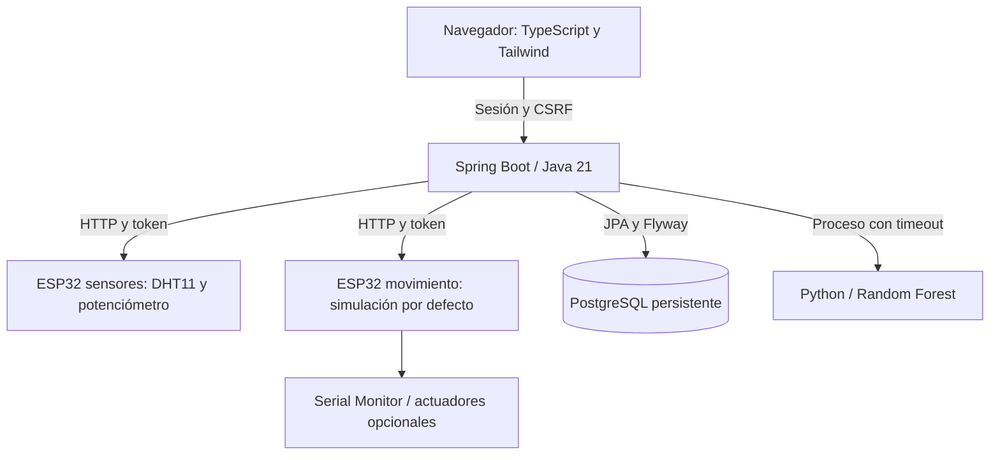

# PlantClassifier

PlantClassifier permite conducir un robot con W/A/S/D y consultar qué cultivo sugiere
un modelo a partir de temperatura, humedad y pH. La página se comunica con Spring Boot;
el servidor guarda las mediciones en PostgreSQL y ejecuta Python para predecir.

Hay **dos ESP32 independientes**:

- **Sensores:** DHT11 real para temperatura/humedad y potenciómetro para simular pH.
  El potenciómetro no mide pH químico. La interfaz y la base de datos conservan ese origen.
- **Movimiento:** recibe comandos HTTP autenticados. Por defecto solo los imprime en
  Serial Monitor; activar el TB6612FNG y el servo requiere revisar el hardware.



## Iniciar la aplicación

Necesitas Docker con Compose. Desde la raíz, copia `.env.example` a `.env` **solo si
no existe**, configura credenciales privadas y las dos direcciones ESP32. No uses los
valores `REPLACE_`. `CONTROL_PASSWORD` necesita al menos 12 caracteres y `DEVICE_TOKEN`
al menos 32; el token debe coincidir en Spring y ambos ESP32. Puedes generar valores
independientes con `openssl rand -hex 32`.

```bash
test -f .env || cp .env.example .env
# Editar .env antes de continuar.
docker compose up -d --build --wait
```

Abre `http://localhost:8080`, inicia sesión y pulsa **Capture Data** o usa W/A/S/D.
Si ya tienes datos, conserva el mismo nombre de proyecto Compose y volumen. Para una
base anterior a Flyway, sigue [MIGRATIONS](docs/MIGRATIONS.md) antes de arrancar.
Nunca necesitas borrar volúmenes para ejecutar esta guía.

## Simulación sin placas

Con el mismo `.env`, este único overlay sustituye las dos placas por dos servidores
Python separados. Mantiene Spring, PostgreSQL y el modelo real:

```bash
docker compose -f docker-compose.yaml -f docker-compose.simulation.yaml up -d --build --wait
docker compose -f docker-compose.yaml -f docker-compose.simulation.yaml logs -f simulator
```

Las mediciones aparecen como simuladas por software. Para volver a las placas,
ejecuta el comando normal de arranque. USB sirve para alimentar, cargar firmware y
observar Serial; los comandos siguen viajando por Wi-Fi/HTTP.

## Cómo funciona

**Movimiento:** una tecla determina la dirección; la última pulsada tiene prioridad.
El frontend adquiere control si hace falta, envía un comando y espera su confirmación.
Los cambios de dirección pendientes se reducen al más reciente. Soltar todas las teclas,
perder foco o pulsar STOP envía STOP inmediatamente. Un error cancela el movimiento;
hay que soltar y volver a pulsar. LEFT/RIGHT orientan el servo y detienen la propulsión.

**Captura:** consultar ESP32 → validar valores y origen → guardar medición → ejecutar
Python → guardar predicción → devolver resultado. Si falla ML, la medición permanece
con estado `FAILED`; si falla el último guardado, queda `PENDING` para diagnóstico.
La última medición se consulta directamente en la base de datos.

| Clase o archivo principal | Responsabilidad |
|---|---|
| `PlantClassifierApplication` | Arrancar Spring Boot |
| `SecurityConfig`, `DeviceClients` | Login/CSRF y conexiones autenticadas con límites de tiempo |
| `LoginController`, `SessionController` | Formulario, estado de sesión y token CSRF |
| `MovementController`, `SensorDataController` | Recibir solicitudes HTTP válidas |
| `MovementService` | Propietario del control, secuencias, vencimiento y confirmaciones |
| `SensorDataService` | Captura, validación, persistencia y predicción |
| `MLService` | Ejecutar Python con timeout, salida limitada y limpieza de procesos |
| `DeviceResponse`, `GlobalExceptionHandler`, `SystemFailure` | Validar respuestas y comunicar errores seguros |
| `SensorData`, `SensorDataRepository` | Entidad JPA y consulta de la última medición |
| `MovementRequestDTO`, `MovementAck`, `CaptureResponse` | Contratos de comunicación sin exponer la entidad |
| `frontend/control.ts`, `frontend/scripts.ts` | Control del teclado y conexión de la interfaz con la API |
| `Movement.ino` y sus headers | `setup`: Wi-Fi/hardware; `handleMovement`: comando; `motorDrive`: motor; `robotStop`: STOP; `loop`: seguridad |
| `PlantClassifier.ino` y sus headers | Leer DHT/potenciómetro y servir `/capture` y `/status` |
| `predict.py`, `features.py`, `train.py` | Inferencia, orden de variables y evaluación reproducible |

## Seguridad y límites

Se conservan login, CSRF, token privado del dispositivo, secuencias crecientes y sesiones
que STOP invalida. Un FORWARD retrasado no puede reactivar esa sesión. También se
conservan watchdog de 1500 ms, STOP al perder Wi-Fi, interbloqueo de inversión y límites
de comunicación. Una confirmación acredita aceptación del comando, **no movimiento físico**.
HTTP del ESP32 requiere una red aislada de confianza; no publiques sus puertos.

No se han validado físicamente el cableado, las fuentes, el recorrido del servo, la
inversión/parada del motor ni el watchdog bajo fallos reales de radio. Usa ruedas
levantadas y desconexión física de emergencia. Lee [la guía física](docs/REAL_HARDWARE_SETUP.md)
antes de conectar actuadores y [SECURITY](docs/SECURITY.md) para credenciales y despliegue.

El modelo y sus datos se conservan. La evaluación en `MLClassification/evaluation.json`
corresponde a un candidato con partición de prueba, no a una evaluación independiente del
modelo desplegado. No demuestra precisión de campo ni sustituye una medición real de pH.

Consulta [SETUP](docs/SETUP.md) para IntelliJ, firmware USB y pruebas, y
[CONTROL_PROTOCOL](docs/CONTROL_PROTOCOL.md) para el contrato HTTP y las carreras con STOP.
